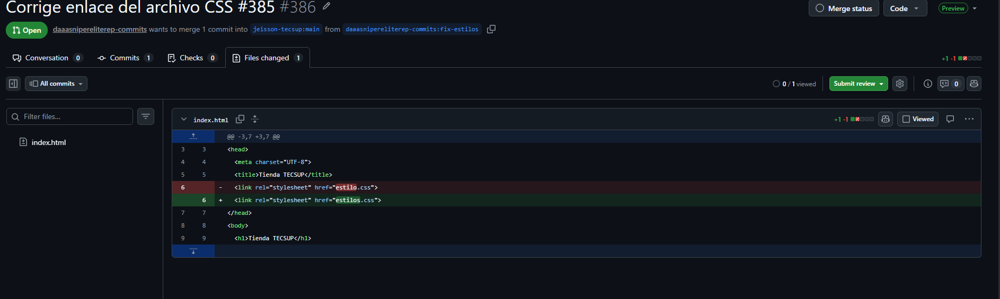

# Mi portafolio

Trabajos del curso Diseno de Interfaces de Programacion Avanzado.

## Sobre mi

Estudiante de Diseno y Desarrollo de Software en Tecsup.

## Contenido

### Trabajos del modulo 1

## Herramientas que uso

**Git** para el control de versiones
**GitHub** para el repositorio remoto
*Visual Studio Code* como editor

## Pasos para clonar este proyecto

1. Copiar la direccion desde el boton Code
2. Ejecutar git clone con esa direccion
3. Entrar a la carpeta con cd

## Mi avance del modulo

- [x] Laboratorio 01: Git basico
- [x] Laboratorio 03: Trabajo colaborativo
- [ ] Laboratorio 04: Markdown

## Enlaces utiles

- [Guia oficial de Markdown](https://www.markdownguide.org/)
- [Mi perfil de GitHub](https://github.com/PieroRB-alt)

## Captura de mi trabajo



## Comandos que mas uso

Para ver el estado del proyecto uso `git status`.

```bash
git add .
git commit -m "Actualiza el README"
git push origin main

¡Excelente! En la captura "image_d2fb48.png" podemos observar que pegaste el código de Markdown en el lado izquierdo y, en el panel derecho, la imagen `captura.png` se renderizó correctamente debajo de los enlaces azules.

Copia y pega tu captura de pantalla dividida directamente en tu documento de Word bajo la sección del **Ejercicio 4**.

Ahora pasaremos al **Ejercicio 5: Código, tablas y citas**. Este es muy importante para la documentación técnica. Sigue estos pasos en Visual Studio Code:

1. **Agrega el nuevo contenido:** Copia el siguiente código y pégalo al final de tu archivo `README.md` (debajo de la línea de tu captura de pantalla):


```markdown
## Comandos que mas uso

Para ver el estado del proyecto uso `git status`.

```bash
git add .
git commit -m "Actualiza el README"
git push origin main

```

| Comando | Que hace |
| --- | --- |
| git add | Prepara los cambios |
| git commit | Guarda la version |
| git push | Sube los cambios al remoto |


> Documentar es parte del trabajo, no un extra al final.
